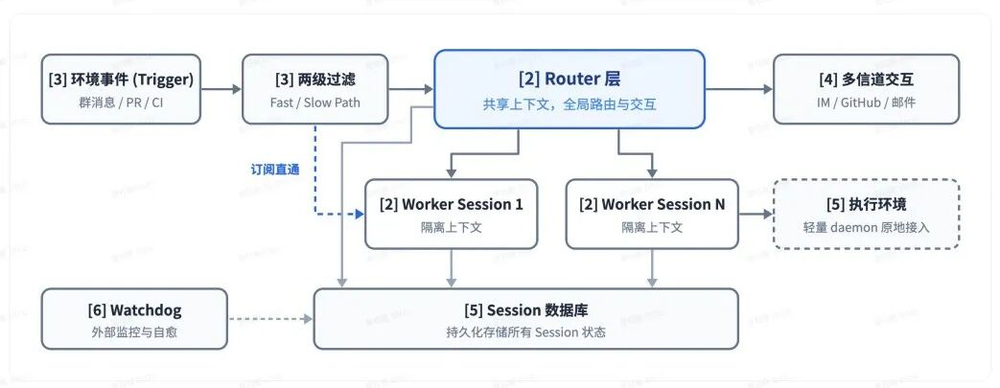

## 1.为什么提出Super-agent

随着模型独立执行任务和多 Agent 协作能力提升，Agent 开始接入消息、日程、邮件等工作环境。但现有系统仍以独立 Session 为主，多任务推进需要用户手动切换会话、同步上下文，人的注意力逐渐成为限制。

Super-agent 希望打破 Agent 与单次会话的绑定，使其成为能跨会话保持上下文、并行推进任务的持续协作者，具备四个特征：连续，跨信道承接同一任务；高效，并行执行且及时响应；主动，根据环境事件判断是否介入；持久，长期在线并能从异常中恢复。

为此，文章提出五个支撑模块：双层架构、事件驱动、面向人的交互、计算与状态及执行环境分离，以及外部 Watchdog。

下图展示了 Super-agent 的整体系统架构，图中各模块的标号 [2] 至 [6] 分别对应原文第 2 至第 6 节：

多任务场景中，人的负担除了下达指令和验收，还包括维护各个任务的上下文、同步新决定，以及理解不同 Agent 的进度反馈。即使任务彼此独立，频繁切换也需要人反复恢复工作背景。

要把这些工作交给系统，还需要解决几个具体问题：同一任务的信息分散在不同平台，怎样识别关联并同步需求变化；多个任务并行时，怎样避免执行阻塞和上下文干扰；持续收到外部消息时，怎样判断是否行动、是否通知用户；进程中断或执行失败后，怎样确认实际进度并恢复工作。

这些问题涉及任务调度、信息组织、交互和运行保障，单靠模型完成某项任务的能力还不够。Super-agent 尝试在系统层面承担这些职责，但是否真正减轻人的负担，还取决于它能否准确汇总进展，并在需要人判断时提供足够的信息。
