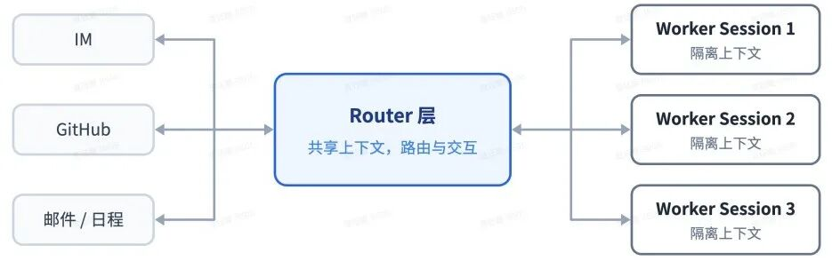

## 2. 双层架构

从使用体验看，用户希望通过统一入口管理多个项目，由系统掌握相关背景并协调工作，就像与一位了解各项目进展的助手交流。但统一入口不必对应单一 Session：将全部任务放进同一个会话，容易受到串行执行和上下文混杂的影响；将任务完全拆到独立会话，又容易缺少全局协调。

为了兼顾连续性与吞吐量，Super-agent 将“维护全局连续性”与“高并发执行”拆分到两个不同的层级中：职责分为 Router 和 Worker 两层，分别负责全局连续性与并发执行。由常驻的 **Router 层**（2.1 节）统一承接人类交互与全局协调，由上下文隔离的 **Worker 层**（2.2 节）并发执行具体任务，如下图所示：

<figure class="blog-figure">
  
  <figcaption>双层架构：Router 层统一负责路由与对外交互，多个 Worker Session 隔离并发执行任务</figcaption>
</figure>

### 2.1 Router 层

Router 负责统一承接人类交互、汇总跨任务信息和分派任务，不直接执行具体工作，也不深入拆解单个任务，因此可以使用较轻量的模型。事件密集时，可将积压事件合并到一次模型调用中处理，提高吞吐；规模继续扩大后，也可分片，但需要权衡分片之间的上下文连续性。

### 2.2 Worker 层

各 Worker 在隔离的上下文中并行执行具体任务，配备完整工具，通常使用能力较强的模型。执行状态与关键结论汇报给 Router，由其统一对外回复。复杂任务可在 Worker 内部继续调用 Subagent 或组织 Agent Team，因此“双层”是职责划分，不限制实际会话数量。

这种分工的关键在于控制 Router 的职责范围。如果它仍需深入每个任务、频繁协调执行细节，就容易重新成为瓶颈。但职责轻量也需要信息支持：Worker 应及时汇报关键进展和阻塞，需求变化也要传递到相关任务，否则全局协调可能基于过时状态作出判断。

另外，上下文隔离不等于工作环境隔离。多个 Worker 操作同一项目，仍可能修改相同文件或产生不兼容的接口变更。因此，并行执行还需要明确任务边界、处理依赖关系，并进行集成验证。增加 Worker 数量能否提高效率，取决于任务的独立程度和协调成本。

Router 和 Worker 可以类比为负责跨项目协调的秘书或项目集经理，与各个项目的执行团队。Router 承接外部请求、分派任务、协调跨任务依赖，并汇总结果；Worker 负责单个任务内部的规划与执行，必要时自行组织“人手”，再向 Router 汇报关键进展与结果。Router 层也可以由多个承担不同职责的 Agent 组成，但需要相应的信息同步与协调机制，才能维持全局连续性。
