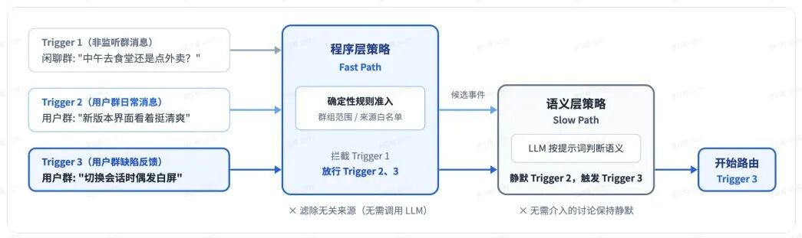
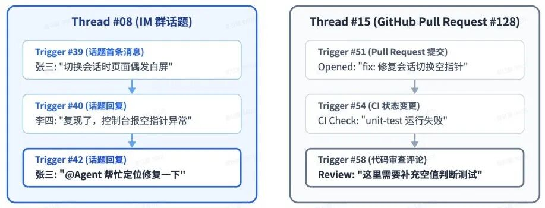
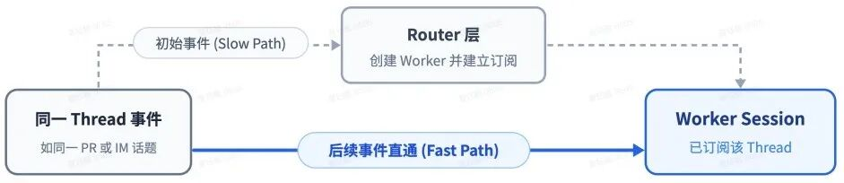
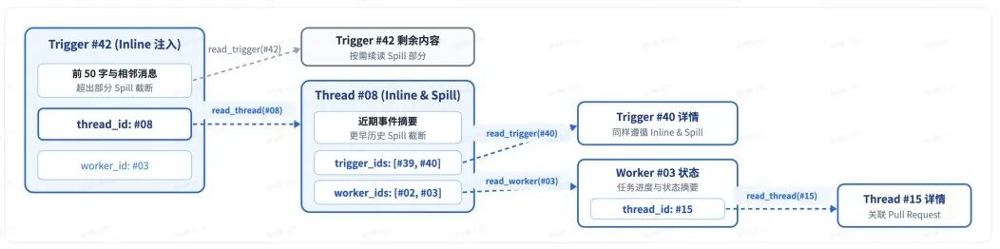
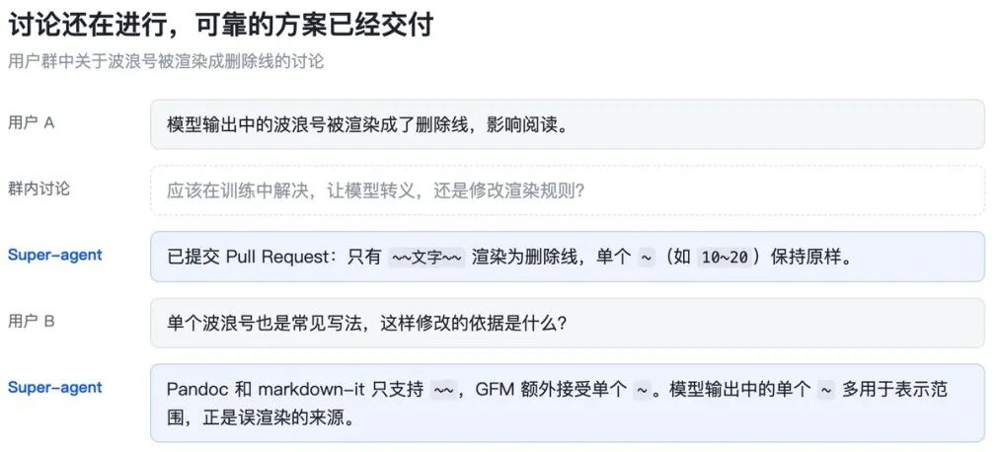

## 3. 事件驱动

要让 Agent 主动参与工作，系统需要持续接收环境中的变化。Super-agent 将群聊消息、邮件与日程提醒、代码审查评论、CI 运行结果等称为 Trigger，由这些事件驱动后续判断与执行。

但接收事件只是入口。多来源消息中，并非所有内容都需要 Agent 处理，全部交给 LLM 判断会产生大量开销。因此，系统还需要解决哪些事件值得处理、交给哪个 Worker、附带多少上下文，以及何时可以在明确指令到来前提前开展工作，分别对应事件过滤、事件路由、上下文组织和提前行动。

### 3.1 事件过滤

真实环境中的消息量很大，但多数并不需要 Agent 介入。

Super-agent 先通过程序规则检查事件来源、群组范围和白名单等确定性条件，例如忽略未纳入服务范围的群组（如闲聊群、不相关的业务群等）、指定类型的自动通知（如邮箱订阅的广告）等等，完成低成本的初步筛选；再让模型结合策略与上下文，判断剩余候选事件是否需要行动。

这种两级过滤将程序层的确定性处理作为 Fast Path，将需要语义理解的模型判断作为 Slow Path，减少无效调用。程序规则负责执行明确的准入条件，模型负责处理依赖语境的判断。如下图所示：

<figure class="blog-figure">
  
  <figcaption>两级过滤：先由程序层策略筛除大部分无关消息，再交由语义层策略判断。</figcaption>
</figure>

### 3.2 事件路由

现在什么消息该传递已经初步解决了，但是如果每条后续消息都需要 Router 调用工具转发给 Worker，仍然会给系统带来很高的调度开销和排队延迟。

在 Super-agent 中，会对已经确定任务归属的消息建立直接投递路径，进一步减轻 Router 压力。同一个 PR、群聊话题或邮件串中的连续 Trigger 构成 Thread

<figure class="blog-figure">
  
  <figcaption>Thread 示例：同一个 IM 话题或同一个 GitHub Pull Request 下的连续 Trigger 构成一条 Thread</figcaption>
</figure>

Router 根据初始事件创建 Worker 后，Worker 可以订阅相关 Thread，后续事件由程序直接投递至所有有关联的 Worker，无需 Router 逐条转发（已订阅，Fast Path）。Router 仍可观测事件以掌握全局状态，但主要负责新任务的分派和跨任务协调（未订阅，Slow Path）。

<figure class="blog-figure">
  
  <figcaption>订阅与直通：初始事件经由 Router 层创建 Worker 并建立订阅，同一 Thread 的后续事件直接发往该 Worker</figcaption>
</figure>

Thread 与 Worker 之间支持多对多订阅：一个任务可以关联多个信息来源，同一个讨论也可能涉及多个任务。Worker 与 Thread之间的订阅关系也是可变的，当事件超出当前任务范围时，Worker 可以取消订阅或交回 Router 重新分派。最终的关键结论仍由 Worker 汇报给 Router，再由 Router 统一对外反馈，以此 保持交互的一致性。

### 3.3 上下文组织

上下文的装载方式会影响模型获得的信息、推理效果和调用成本。

Super-agent 用 Inline 与 Spill 管理上下文：近期可能使用的信息直接放入窗口（Inline）;较长或低频内容保留在外部（Spill），窗口内只留下必要的摘要和引用，供模型按需读取。

这个思路跟很多 compact 的设计异曲同工，二者都控制上下文规模，但处理环节不同：compact 主要压缩已经积累的历史，Inline／Spill 则侧重决定哪些信息现在装载、哪些留待后续读取。两种机制可以配合使用，但压缩本身并不保证被省略的信息仍然可查。

由于窗口容量有限，模型可能需要读取外部内容。为定位关联信息，系统为事件、Thread 和 Worker Session 分配唯一 ID，并在对象中保留相关对象的引用。读取一个对象时即可获得下一步可访问的关联入口，沿引用逐步补充背景，形成链式召回，无需一次加载全部历史。

<figure class="blog-figure">
  
  <figcaption>链式召回：每次召回的对象均内联下一跳关联对象的 ID，支持沿引用关系逐跳展开上下文</figcaption>
</figure>

### 3.4 提前行动

有些环境信息尚未形成明确指令，但已经提供了可以开展准备工作的线索。

Super-agent 可以根据这些信号提前进行尝试，例如看到问题反馈后先自行尝试复现，借鉴投机执行的思路，用额外计算换取更短的等待时间，并只在结果值得交付时通知用户，使用户有机会在明确提出请求前，就获得可用的分析或解决方案。

<figure class="blog-figure">
  
  <figcaption>投机执行示例：群内还在讨论解决方案时，Super-agent 已在后台提交了修复 Pull Request</figcaption>
</figure>

当然，提前尝试不保证产生有效结果，也会带来未被采用的计算开销。因此，它主要改善的是响应时效，不一定提高单位算力的产出效率。在计算预算允许、任务命中率较高且操作影响可控的情况下，这是一种减少用户等待的方法。

第三章围绕环境事件进入系统后的处理过程，介绍了过滤、路由、上下文组织和提前行动。通过这些机制，Agent 可以持续接收外部变化，判断是否需要介入，并将相关信息送到具体任务中，减少用户逐条下令和同步背景的工作。

可以发现，到这一章为止，Super-agent 的设计大量借鉴了已有的工程机制，新意更多体现在将它们合理地组合起来：两级过滤和订阅直通借鉴了 Fast／Slow Path 与发布订阅机制；Inline／Spill 与 compact 都在控制上下文规模，但前者更强调按需装载；提前行动则借鉴投机执行，用额外计算减少等待。通过一套“组合拳”来支撑持续运行的 Agent。

Agent 编排没有适用于所有场景的统一最优形式，需要根据任务特点、交互需求和资源约束选择合适的“配件”。因此，实际开发时也可以参考 DeepSeek Harness 团队的设计思路，从 Super-agent 中提取适合自身需求的机制，逐步落地并验证效果。
